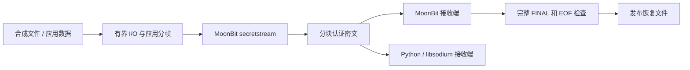

# mb-secure-stream

[Mooncakes 0.2.0](https://mooncakes.io/docs/ChenJiasen-123/mb-secure-stream@0.2.0) · [安装与复现](docs/getting-started.md) · [架构](docs/architecture.md) · [来源与许可](docs/attribution.md)

用 MoonBit 实现兼容 libsodium secretstream 的流式认证加密，让 MoonBit 应用能与 Python/libsodium 交换分块加密数据。面向加密备份、文件传输和存储组件集成。

**当前为未经安全审计的实验版本。** 已验证协议互通和明确的失败行为；不保证恒定时间、生产安全或性能优势。密钥存储、密码派生、备份恢复策略由应用负责。

## 它解决什么问题

- **跨语言交换数据**：MoonBit 加密可以由 libsodium 解密，反向也有独立验证。
- **检测不完整传输**：支持显式与计数器溢出的自动重密钥、FINAL 和截断拒绝。
- **失败不发布恢复文件**：文件示例在完整验证前只写独占临时文件，失败清理，不覆盖已有目标。

生态已有密码库和分块 AEAD；本项目的重点是 libsodium secretstream 的帧格式、状态行为和可复现互通，而非算法数量。

## 架构

密码计算在 MoonBit 内完成；Node 负责文件读写和输出发布，Python 提供独立参考。文件示例的 MBSS0001 容器是项目自定义封装，其内部帧与 libsodium secretstream 兼容。[查看组件分工、恢复流程与信任边界](docs/architecture.md)。

## 开始体验

| 目的 | 入口 |
|---|---|
| 安装已发布库或从源码构建 | [安装与复现](docs/getting-started.md) |
| 加密并恢复合成文件 | [文件 CLI 示例](examples/secretstream-file/README.md) |
| 复现双向互通、篡改和截断拒绝 | [独立验证说明](docs/getting-started.md#独立互通与异常输入) |
| 了解 WasmGC 宿主接入 | [Node Web Crypto 宿主示例](examples/secretstream-wasm/README.md) |
| 集成到自己的程序 | [独立接口指南](docs/secretstream-api.md) |

## 已有证据与限制

- 全仓 156 项 MoonBit 测试、secretstream JS 5 项测试；CLI 启动与写入故障回归纳入修复分支 CI。精确结果以对应提交的 CI 为准。
- 独立差分默认验证 32 条流 / 800 帧，逐字节比较密文及明文/tag，检查 5,536 次畸形输入拒绝和 800 次提前完成检查后的恢复。
- 文件验证包含双向哈希匹配、八类损坏输入、临时文件清理及已有输出保护；重复测量工具保存各轮原始结果和运行参数。
- JS、Linux Native 和 Node Web Crypto WasmGC 有运行证据。Windows Native、其他 WasmGC 宿主及线性内存 Wasm 尚未验证。
- 文件默认分块 64 KiB。总进程 RSS 包含运行时、JIT 和 GC，不等于算法工作内存；目前仍有较明显分配开销。

[验证代码与工具](tools/) · [CI 记录](https://github.com/ChenJiasen-123/mb-secure-stream/actions) · [版本记录](CHANGELOG.md)

## 本期工作与历史代码

本期重点是 secretstream 状态机、Bytes 封装、安全随机发送工厂、跨语言向量与差分验证、文件完整性和失败发布语义。仓库中已有 JWT、网关和基础密码模块属于历史工作，不能将其全部计为本期新增。

基础密码模块源自 moonbit-crypto/mb-crypto；secretstream 参考 libsodium，保留对应来源及许可。[详细衍生关系](docs/attribution.md) · [历史 JWT/网关接口](docs/gateway-api.md)。

## 贡献与反馈

欢迎报告可复现问题、平台验证和接入体验。[提交 Issue](https://github.com/ChenJiasen-123/mb-secure-stream/issues)，附工具链版本、操作系统、完整命令和经过脱敏的错误信息。请使用合成文件复现，不提交私钥、凭据或私人明文。

后续重点：完整安全恢复应用示例、类型化标签与错误、分配分析和优化、外部试用反馈。已有验证不能替代独立安全审查。

## 许可证

主体为 [Apache-2.0](LICENSE)，libsodium 参考部分保留 ISC 版权许可。见 [来源说明](docs/attribution.md) 与 [secretstream NOTICE](crypto/mb-secretstream/NOTICE)。
