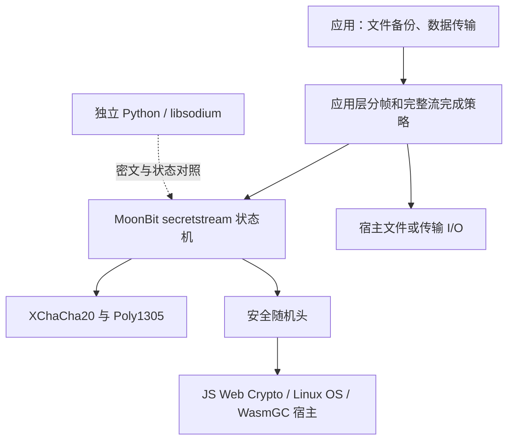
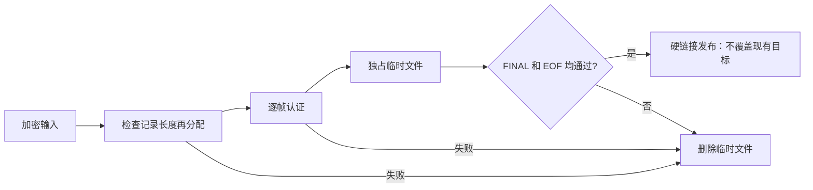

# 架构与信任边界

## 协议与宿主分工

密码计算由 MoonBit 实现。Node 文件适配器负责有界读写、临时文件和输出发布，不替代密码实现。Python 是独立互通参考，不是运行 MoonBit 库的必要依赖。

## 安全恢复的文件生命周期

通过一帧认证只证明该帧，不能证明文件没有截断。临时文件内可能含已认证的部分明文，但不作为成功输出发布；依赖系统文件权限，并不保证存储介质擦除。

## 格式与限制

示例容器为 `MBSS0001`、24 字节头、重复的四字节小端长度和密文帧，末尾为空 FINAL 帧。它是项目自定义封装；内部帧才与 libsodium secretstream 兼容。每帧明文/AAD 上限各为 1 MiB，默认文件分块 64 KiB。

库不负责密码派生、密钥保存与恢复、网络重传、文件名与元数据恢复。JS、Linux Native、Node Web Crypto WasmGC 有运行证据；其他宿主需单独验证。实现未经安全审计，不能推导恒定时间或生产安全保证。
