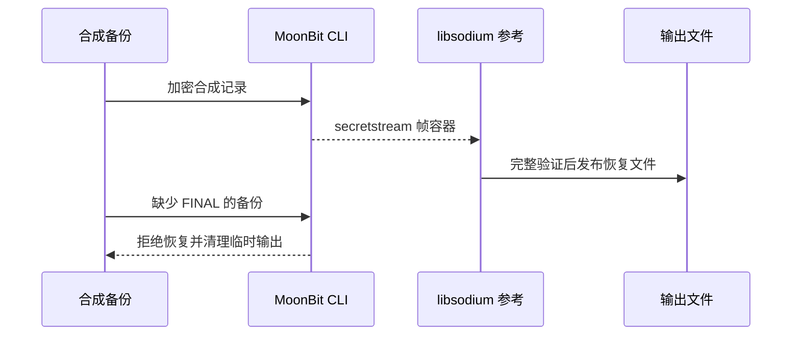

# 跨语言备份与安全恢复演示

一条命令生成合成备份、双向加密恢复，并证明不完整备份不会被发布为恢复成功的文件。密码实现仍是 MoonBit 库与独立 libsodium，不新增密码协议。

```sh
moon build --target js examples/secretstream-file/bridge
python -m pip install -r tools/requirements-dev.txt
python examples/secure-backup/demo.py backup-demo.json
```

需要 MoonBit 0.10.15、Node 24、Python 3.12 与支持硬链接的文件系统。Python 依赖装入虚拟环境。报告路径必须不存在，避免覆盖旧结果。

演示不读取任何用户文件：创建包含 10,000 条记录的合成 JSONL 备份和随机测试密钥，在临时目录完成以下流程，最后移除临时目录，只留下不含密钥和明文的验证报告。

1. MoonBit 加密 → Python/libsodium 恢复，比较文件哈希与完整记录内容。
2. Python/libsodium 加密 → MoonBit 恢复，执行相同检查。
3. 删除最终完成帧，双方恢复必须失败；不产生成功输出，不遗留临时明文。
4. 对已有恢复路径重试，原文件必须保持不变。



应用边界：示例只备份单个文件，不负责目录快照一致性、文件权限/元数据恢复、密钥托管、密码派生或密钥丢失后的恢复。实际使用文件 CLI 时需独立安全保存密钥，不与密文一起分发。文件权限和删除不等于可靠擦除。实现未经安全审计，不应把演示成功作为生产安全保证。

进一步阅读：[组件和恢复流程](../../docs/architecture.md)、[文件 CLI](../secretstream-file/README.md)、[安装与复现](../../docs/getting-started.md)。
