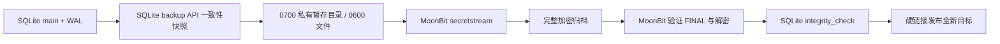

# SQLite 加密快照备份与恢复

这是对 MoonBit secretstream 的实际应用接入：Python 标准库负责 SQLite 一致性快照和数据库检查；Node 只做文件 I/O；加解密仍由编译后的 MoonBit 实现执行。

## 构建与验证

需要 MoonBit 0.10.15、Node 24、Python 3.12，以及支持同目录硬链接的可信本地文件系统。在仓库根目录执行：

```sh
moon build --target js examples/secretstream-file/bridge
python -m pip install -r tools/requirements-dev.txt
python tools/test_sqlite_backup.py
```

测试只创建合成数据库，不访问用户数据库。它保留活跃 WAL 和未提交事务，检查已提交数据恢复，并使用 Python/libsodium 独立解密对比。其他测试覆盖损坏输入、非数据库内容、目标保护、发布竞态和清理失败。

## 备份自己的数据库

先创建一个新的二进制密钥文件，保存到受保护位置；示例命令不会覆盖已有密钥：

```sh
python -c "import os; f=os.fdopen(os.open('backup.key',os.O_WRONLY|os.O_CREAT|os.O_EXCL,0o600),'wb'); f.write(os.urandom(32)); f.close()"
python examples/sqlite-backup/backup.py backup app.sqlite app-backup.mbss backup.key
python examples/sqlite-backup/backup.py restore app-backup.mbss restored.sqlite backup.key
```

输入可以替换为你有权备份的实际数据库。输出父目录必须已存在且可信，目标必须是全新文件。恢复还要求目标名对应的 `-wal`、`-shm`、`-journal` 均不存在，以免混入旧 sidecar。不要把恢复文件直接覆盖正在运行的数据库；先独立验证，再由应用执行停机切换。

每次命令返回 JSON。`outputCommitted: true` 表示已发布；若 `cleanupWarnings` 非空，按提示清理残留私有目录，不要盲目重试。密钥不会写入归档或报告；需另行安全备份，丢失后无法恢复。Windows 上还需配置合适的目录 ACL，POSIX 的 0600/0700 模式位不能替代 Windows 权限管理。

## 流程与边界



使用 SQLite backup API 而非复制主文件，避免遗漏已提交 WAL 数据；只备份 `main` 数据库，不自动包含 ATTACH 数据库、外部文件、密钥或应用配置。持续高写入可能使备份反复重试，失败不会发布结果。`--timeout-seconds` 默认为 120（各阶段预算，最大 3600）；SQLite 回调/进度处理器提供合作式截止检查，Node 子进程有超时。它不是整个命令的严格总时限。

快照和恢复检查需要在私有暂存目录中落地明文，并需要相应磁盘空间。成功与正常异常路径会清理暂存；强制终止、断电或清理错误可能留下文件。不保证秘密擦除、目录断电持久性、抗恶意目录替换或恶意数据库的绝对安全。输出父目录和数据库路径必须由可信用户控制。

SQLite `integrity_check` 检查数据库结构，不证明业务逻辑、外键完整性或备份来自期望的业务系统；归档也没有防回滚元数据或数据库身份绑定。恢复后仍需由应用验证版本和业务数据。该应用是未经安全审计的实验实现；在线服务部署和密钥管理不在此示例内。

参考：[SQLite Online Backup API](https://www.sqlite.org/backup.html)、[Python sqlite3.Connection.backup](https://docs.python.org/3/library/sqlite3.html#sqlite3.Connection.backup)。
